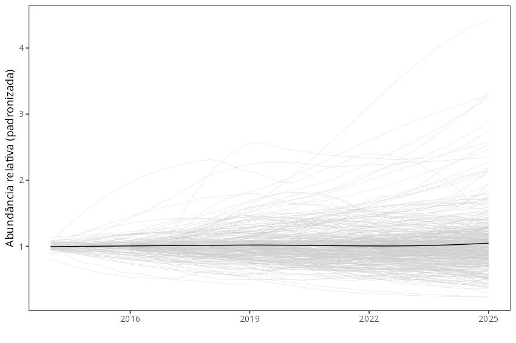

# monitora-florestal-pipelines

Workflow para construir produtos de dados do [Programa Monitora ICMBio](https://www.gov.br/icmbio/pt-br/assuntos/monitoramento), protocolo básico, alvos aves e mamíferos de médio e grande porte. O principal objetivo desse workflow é transformar os dados do programa Monitora em Variáveis Essenciais de Biodiversidade - EBVs. EBVs são medidas padronizadas usadas para monitorar e relatar mudanças na biodiversidade global. Eles atuam como camada intermediária entre os dados brutos obtidos em campo, e indicadores agregados de biodiversidade (e.g., [Kissling et al., 2017](https://doi.org/10.1111/brv.12359)).

Primeiramente, os dados passam por um controle de qualidade, visando garantir sua consistência em termos de formatos de data, taxonomia e coordenadas espaciais (a ser implementado), de forma a se tornarem dados utilizáveis para EBV ("EBV-usable data sets").

Em seguida, os dados de populações selecionadas são inseridos em um modelo populacional N-mixture para se tornarem dados compatíveis com EBV ("EBV-ready data"). Mais especificamente, o  modelo estima a abundância relativa das populações, o que equivale à EBV "abundância de espécies" (classe de EBV "populações de espécies", [Jetz et al., 2019](https://www.nature.com/articles/s41559-019-0826-1)).

Estas estimativas populacionais podem ser usadas na produção de índices agregados de tendências de biodiversidade, como o Living Planet Index - LPI, e outros.




## Estrutura do diretório

``` bash
├───01_entrada
├───02_scripts
|   ├───funcoes
└───03_saida
```

## Nota aos colaboradores

Para todas as funções, nomes de objetos, etc, usar o [tidyverse style guide](https://style.tidyverse.org/)

Criar novos branches para modificações

## Workflow

Curadoria dos dados brutos, baixados diretamente da página do Programa Monitora do ICMBio [Programa Monitora do ICMBio](https://www.gov.br/icmbio/pt-br/assuntos/monitoramento/conteudo/dados/dados_florestal_monitora/view)

Controle de qualidade dos dados (data, taxonomia, duplicações)


## Nota sobre os dados:
Arquivos binários (e.g., .csv e .rds) não foram incluídos neste repositório para evitar lentidão no Git e respeitar os limites de armazenamento do GitHub.
Assim, este repositório contém apenas o código necessário para processar os dados, assumindo que os arquivos de entrada estejam disponíveis localmente no diretório principal do repositório.


# Contato

[elildojr\@gmail.com](mailto:elildojr@gmail.com)
